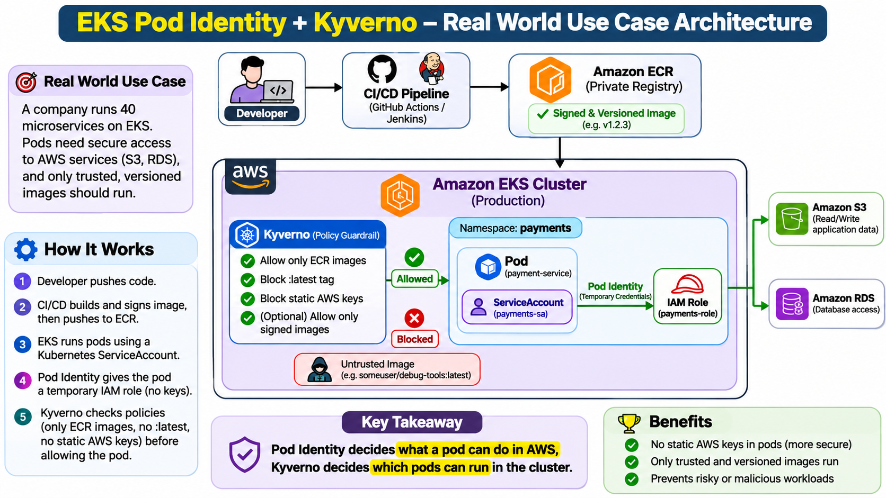

# EKS Workload Identity and Kyverno Guardrails

A practical guide to giving Amazon EKS workloads AWS permissions without
static access keys, then using Kyverno to enforce workload security
policies.

> **Audience:** DevOps engineers, Kubernetes learners, and platform
> teams\
> **Example workload:** `uploader` in namespace `media`, allowed to read
> one S3 bucket\
> **Important:** This is a teaching guide. Test every manifest on a
> non-production cluster and verify compatibility with your installed
> EKS, Kubernetes, and Kyverno versions before production use.

------------------------------------------------------------------------

## Table of contents

1.  [Architecture at a glance](#architecture-at-a-glance)
2.  [Prerequisites](#prerequisites)
3.  [EKS Pod Identity: Console
    walkthrough](#eks-pod-identity-console-walkthrough)
4.  [Deploy and verify the workload](#deploy-and-verify-the-workload)
5.  [Other setup methods](#other-setup-methods)
6.  [IRSA: the alternative](#irsa-the-alternative)
7.  [Kyverno overview and
    installation](#kyverno-overview-and-installation)
8.  [Policy 1: block static AWS access
    keys](#policy-1-block-static-aws-access-keys)
9.  [Policy 2: allow only trusted ECR
    images](#policy-2-allow-only-trusted-ecr-images)
10. [Safe production rollout](#safe-production-rollout)
11. [Current Kyverno policy types](#current-kyverno-policy-types)
12. [Validation and troubleshooting](#validation-and-troubleshooting)
13. [Production checklist](#production-checklist)
14. [Key takeaway](#key-takeaway)
15. [Official references](#official-references)

------------------------------------------------------------------------

## Architecture at a glance

### Real-world EKS workload security architecture

The diagram below shows how a developer's code moves through CI/CD and Amazon ECR into EKS, where Kyverno checks workload policies and Pod Identity provides temporary AWS credentials to approved Pods.




### The problem

A Pod sometimes needs to call AWS services such as S3, SQS, DynamoDB, or
Secrets Manager. Putting long-lived AWS access keys in a container
image, environment variable, ConfigMap, or Kubernetes Secret increases
the risk of credential exposure.

### The solution: workload identity

Associate an IAM role with a Kubernetes ServiceAccount. A Pod that uses
that ServiceAccount receives temporary AWS credentials through the
supported identity mechanism.

-   **EKS Pod Identity:** the newer, simpler option for supported EKS
    workloads.
-   **IRSA (IAM Roles for Service Accounts):** the OIDC-based option,
    still useful where Pod Identity is not supported or suitable,
    including EKS Fargate workloads.

### Where Kyverno fits

Kyverno is a Kubernetes policy engine. It can validate, mutate,
generate, and delete resources, and verify container image signatures
and attestations.

-   **Pod Identity / IRSA:** controls what an approved workload can do
    in AWS.
-   **Kyverno:** controls which Kubernetes resources are allowed to be
    admitted and how they are configured.

Use both layers. Neither replaces the other.

------------------------------------------------------------------------

## Prerequisites

Before starting, make sure you have:

-   An Amazon EKS cluster and a working `kubectl` context.
-   Permission to manage EKS add-ons and Pod Identity associations.
-   Permission to create IAM policies and roles.
-   An S3 bucket for the example.
-   A test namespace and a non-production workload.
-   Helm installed if you plan to install Kyverno using Helm.
-   A Kyverno release that supports the CEL-based
    `policies.kyverno.io/v1` policy APIs used below. The current policy
    samples in this guide target **Kyverno 1.17 or later**; check the
    official compatibility documentation for your exact release and
    Kubernetes version.

Set these shell variables for the examples:

``` bash
export CLUSTER_NAME="prod"
export AWS_REGION="ap-south-1"
export AWS_ACCOUNT_ID="111122223333"
export BUCKET_NAME="my-bucket"
export ECR_REGISTRY="${AWS_ACCOUNT_ID}.dkr.ecr.${AWS_REGION}.amazonaws.com"
```

Replace all example account IDs, regions, bucket names, cluster names,
and registry names with your own values.

------------------------------------------------------------------------

## EKS Pod Identity: Console walkthrough

**Scenario:** An application named `uploader` in namespace `media` needs
read-only access to one S3 bucket.

### Step 1: Install the Pod Identity Agent add-on

1.  Open the **Amazon EKS** console.
2.  Select **Clusters**, then select your cluster.
3.  Open the **Add-ons** tab.
4.  Choose **Get more add-ons**.
5.  Select **Amazon EKS Pod Identity Agent**.
6.  Choose **Next**, review the configuration, and choose **Create**.
7.  Wait for the add-on status to become **Active**.

The Pod Identity Agent runs on the cluster's EC2 worker nodes. Confirm
the add-on is healthy before testing workload identity.

### Step 2: Create a least-privilege IAM policy

1.  Open **IAM → Policies → Create policy**.
2.  Select the **JSON** editor.
3.  Paste the policy below, replacing `my-bucket`.
4.  Name the policy `uploader-s3-read`.

``` json
{
  "Version": "2012-10-17",
  "Statement": [
    {
      "Sid": "ListOnlyTheTargetBucket",
      "Effect": "Allow",
      "Action": "s3:ListBucket",
      "Resource": "arn:aws:s3:::my-bucket"
    },
    {
      "Sid": "ReadObjectsOnlyInTheTargetBucket",
      "Effect": "Allow",
      "Action": "s3:GetObject",
      "Resource": "arn:aws:s3:::my-bucket/*"
    }
  ]
}
```

This policy permits listing the named bucket and reading objects in it.
It does not grant write or delete access.

### Step 3: Create the IAM role for Pod Identity

1.  Open **IAM → Roles → Create role**.
2.  Select the AWS service / EKS Pod Identity trusted entity or use case
    shown by the console.
3.  Attach the `uploader-s3-read` policy.
4.  Name the role `uploader-role`.
5.  Create the role.

The role must trust the EKS Pod Identity service. The essential trust
relationship uses the service principal `pods.eks.amazonaws.com` and
allows `sts:AssumeRole` and `sts:TagSession`. The EKS console's Pod
Identity role workflow can create this trust relationship for you.

For reference, the basic trust policy has this shape:

``` json
{
  "Version": "2012-10-17",
  "Statement": [
    {
      "Sid": "AllowEksAuthToAssumeRoleForPodIdentity",
      "Effect": "Allow",
      "Principal": {
        "Service": "pods.eks.amazonaws.com"
      },
      "Action": [
        "sts:AssumeRole",
        "sts:TagSession"
      ]
    }
  ]
}
```

For production, consider adding trust-policy conditions that restrict
which cluster, namespace, and ServiceAccount may use the role. Follow
the current AWS documentation for the supported condition keys.

### Step 4: Create the Pod Identity association

1.  Return to **Amazon EKS → Clusters → your cluster**.
2.  Open **Access → Pod Identity associations** (the exact console tab
    label may vary).
3.  Choose **Create**.
4.  Select IAM role `uploader-role`.
5.  Enter namespace `media`.
6.  Enter ServiceAccount name `uploader`.
7.  Create the association.

The association is stored by EKS; it is not an annotation on the
Kubernetes ServiceAccount. The namespace and ServiceAccount can be
created before or after the association, but they must exist before the
workload is launched.

------------------------------------------------------------------------

## Deploy and verify the workload

Create the namespace and ServiceAccount:

``` bash
kubectl create namespace media
kubectl -n media create serviceaccount uploader
```

Launch a temporary AWS CLI Pod using that ServiceAccount:

``` bash
kubectl -n media run awscli \
  --image=amazon/aws-cli:latest \
  --restart=Never \
  --overrides='{"spec":{"serviceAccountName":"uploader"}}' \
  --command -- sleep 3600
```

For a production deployment, do not use a floating `latest` image tag.
Pin a reviewed version or immutable digest from a trusted registry.

Check the Pod:

``` bash
kubectl -n media get pod awscli
kubectl -n media describe pod awscli
```

Verify the AWS identity:

``` bash
kubectl -n media exec awscli -- aws sts get-caller-identity
```

Test the intended S3 access:

``` bash
kubectl -n media exec awscli -- aws s3 ls "s3://${BUCKET_NAME}"
```

### Expected result

-   `get-caller-identity` should show an assumed-role identity
    associated with `uploader-role`.
-   The S3 listing should succeed if the bucket exists and the role
    policy permits the operation.

If the Pod was started before the association was ready, recreate it
after the association exists:

``` bash
kubectl -n media delete pod awscli
# Run the kubectl run command again.
```

Do not assume that a successful identity check proves least privilege.
Also test that prohibited actions, such as `s3:PutObject` or
`s3:DeleteObject`, fail.

------------------------------------------------------------------------

## Other setup methods

  -----------------------------------------------------------------------
  Method                  Effort                  Best for
  ----------------------- ----------------------- -----------------------
  AWS Console             Lowest; mostly clicking Learning and classroom
                                                  demonstrations

  `eksctl`                A small number of       Fast setup and labs
                          commands                

  AWS CLI                 Scriptable commands     Lightweight automation

  Terraform /             More initial setup      Repeatable production
  CloudFormation                                  infrastructure and
                                                  multiple clusters
  -----------------------------------------------------------------------

### `eksctl` example

Install the add-on:

``` bash
eksctl create addon \
  --cluster "${CLUSTER_NAME}" \
  --name eks-pod-identity-agent \
  --region "${AWS_REGION}"
```

Create an association and have `eksctl` create the role from the
supplied policy ARN:

``` bash
eksctl create podidentityassociation \
  --cluster "${CLUSTER_NAME}" \
  --region "${AWS_REGION}" \
  --namespace media \
  --service-account-name uploader \
  --create-service-account \
  --permission-policy-arns arn:aws:iam::aws:policy/AmazonS3ReadOnlyAccess
```

This managed policy grants broader S3 read access than the single-bucket
policy above. It is suitable only as a quick demonstration. For real
workloads, use a customer-managed least-privilege policy scoped to the
required bucket and objects. Check the `eksctl` version and command
options before running the command.

### AWS CLI: create the association when the role already exists

``` bash
aws eks create-pod-identity-association \
  --cluster-name "${CLUSTER_NAME}" \
  --namespace media \
  --service-account uploader \
  --role-arn "arn:aws:iam::${AWS_ACCOUNT_ID}:role/uploader-role" \
  --region "${AWS_REGION}"
```

The role must already have the correct Pod Identity trust policy and
permissions policy.

------------------------------------------------------------------------

## IRSA: the alternative

IRSA uses the cluster's OIDC identity provider to allow a Kubernetes
ServiceAccount to assume an IAM role.

Use IRSA when Pod Identity is not supported for your workload or
environment, including EKS Fargate. It is also a valid option for
existing clusters that already use IRSA.

### `eksctl` example

Associate the cluster's OIDC provider:

``` bash
eksctl utils associate-iam-oidc-provider \
  --cluster "${CLUSTER_NAME}" \
  --region "${AWS_REGION}" \
  --approve
```

Create the IAM ServiceAccount:

``` bash
eksctl create iamserviceaccount \
  --cluster "${CLUSTER_NAME}" \
  --region "${AWS_REGION}" \
  --namespace media \
  --name uploader \
  --attach-policy-arn arn:aws:iam::aws:policy/AmazonS3ReadOnlyAccess \
  --approve
```

Again, replace the broad managed policy with a least-privilege policy
for production. Do not mix the Pod Identity association workflow and
IRSA annotation workflow; they are different mechanisms.

------------------------------------------------------------------------

## Kyverno overview and installation

Kyverno evaluates Kubernetes resources against policies. The CEL-based
policy APIs use the `policies.kyverno.io/v1` API group.

### Install Kyverno with Helm

``` bash
helm repo add kyverno https://kyverno.github.io/kyverno/
helm repo update

helm install kyverno kyverno/kyverno \
  --namespace kyverno \
  --create-namespace
```

Check the deployment:

``` bash
kubectl get pods -n kyverno
kubectl get crd | grep -E 'policies.kyverno.io|policyreports'
```

For production, pin and review a specific Helm chart version, configure
high availability and resource requests/limits, and follow Kyverno's
installation and upgrade guidance. Do not assume that an unpinned chart
install will always deploy the same release.

> **API migration note:** This guide intentionally uses the newer
> CEL-based policy types such as `ValidatingPolicy`. Do not copy legacy
> `ClusterPolicy` examples into this guide. Check your installed Kyverno
> release and CRDs before applying these manifests.

------------------------------------------------------------------------

## Policy 1: block static AWS access keys

This policy audits Pods whose regular containers declare the environment
variable names `AWS_ACCESS_KEY_ID` or `AWS_SECRET_ACCESS_KEY`.

Save as `disallow-static-aws-keys.yaml`:

``` yaml
apiVersion: policies.kyverno.io/v1
kind: ValidatingPolicy
metadata:
  name: disallow-static-aws-keys
spec:
  validationActions:
    - Audit
  matchConstraints:
    namespaceSelector:
      matchExpressions:
        - key: kubernetes.io/metadata.name
          operator: NotIn
          values:
            - kube-system
            - kyverno
    resourceRules:
      - apiGroups: [""]
        apiVersions: ["v1"]
        operations: ["CREATE", "UPDATE"]
        resources: ["pods"]
  validations:
    - expression: >-
        object.spec.containers.all(c,
          !has(c.env) ||
          c.env.all(e,
            !(e.name in ["AWS_ACCESS_KEY_ID", "AWS_SECRET_ACCESS_KEY"])
          )
        )
      message: "Do not inject static AWS access keys into Pods. Use EKS Pod Identity or IRSA."
```

Apply and inspect:

``` bash
kubectl apply -f disallow-static-aws-keys.yaml
kubectl get validatingpolicies
kubectl get policyreport -A
```

Start with `Audit`. Review the reports and fix existing workloads. Once
the policy has been tested and exceptions have been reviewed, change:

TEST

``` bash
kubectl -n media run awscli1   --image=amazon/aws-cli:latest   --restart=Never   --overrides='{"spec":{"serviceAccountName":"uploader"}}'   --env="AWS_ACCESS_KEY_ID=HDEUIFHIGFFUFUEAA"  --env="AWS_SECRET_ACCESS_KE=GDIUWFHIFEUWFGUIGFIGEGF "--command -- sleep 3600

```


``` yaml
validationActions:
  - Deny
```

NOW IT WILL FAIL

### Important limitation

This is a teaching guardrail, not a complete secret scanner. It checks
the names of environment variables in regular containers. It does not
prove that credentials are absent from images, mounted files, command
arguments, init containers, ephemeral containers, external secret
stores, or application configuration. Extend and test the policy for
your threat model before treating it as a comprehensive credential
control.

------------------------------------------------------------------------

## Policy 2: allow only trusted ECR images

### Production scenario

A company runs many microservices on EKS. Some workloads have powerful
AWS roles through Pod Identity. A developer deploys a debug image from a
public registry into a sensitive namespace such as `payments`.

If the debug Pod uses a ServiceAccount associated with a privileged IAM
role, code inside that container may be able to use the role's AWS
permissions. The risk is not limited to the image publisher: compromised
packages and untrusted runtime tools can also abuse the workload's
permissions.

### Guardrail

The following policy checks that every regular container image:

1.  Starts with the company's ECR registry prefix.
2.  Does not end with the mutable `:latest` tag.

Replace the example registry with your account, region, and ECR
registry.

Save as `trusted-registry-only.yaml`:

``` yaml
apiVersion: policies.kyverno.io/v1
kind: ValidatingPolicy
metadata:
  name: trusted-registry-only
spec:
  validationActions:
    - Audit
  matchConstraints:
    namespaceSelector:
      matchExpressions:
        - key: kubernetes.io/metadata.name
          operator: NotIn
          values:
            - kube-system
            - kyverno
    resourceRules:
      - apiGroups: [""]
        apiVersions: ["v1"]
        operations: ["CREATE", "UPDATE"]
        resources: ["pods"]
  validations:
    - expression: >-
        object.spec.containers.all(c,
          c.image.startsWith('111122223333.dkr.ecr.ap-south-1.amazonaws.com/')
        )
      message: "All regular container images must come from the approved ECR registry."
    - expression: >-
        object.spec.containers.all(c,
          !c.image.endsWith(':latest')
        )
      message: "The :latest tag is not allowed. Use a version tag or immutable image digest."
```

Apply it:

``` bash
kubectl apply -f trusted-registry-only.yaml
kubectl get validatingpolicies
kubectl get policyreport -A
```

### Important image-policy limitations

-   This example checks `spec.containers`. Extend and test it for
    `initContainers` and `ephemeralContainers` if those are in scope.
-   A registry-prefix check does not prove that an image is safe,
    scanned, signed, or built by a trusted pipeline.
-   A tag other than `latest` can still be mutable. Immutable digests
    provide stronger deployment traceability.
-   Pod-only admission checks do not automatically mean every controller
    template is checked at the point it is created. Configure and test
    controller coverage/autogeneration or explicitly validate workload
    templates as required by your Kyverno version and policy design.
-   Excluding `kube-system` and `kyverno` is a practical teaching
    choice, not a universal security rule. Review namespace exclusions
    carefully; broad exclusions can create bypasses.

------------------------------------------------------------------------

## Safe production rollout

Do not switch a new admission policy directly to `Deny` in a production
cluster.

1.  **Audit first.** Apply the policy with `validationActions: [Audit]`.
2.  **Measure impact.** Review `kubectl get policyreport -A` and
    investigate violations. PolicyReports represent current evaluation
    results; they are not a permanent historical audit log.
3.  **Remediate.** Move approved images into ECR, pin versions or
    digests, and remove static credentials.
4.  **Document exceptions.** Where a workload cannot be remediated
    immediately, use a narrowly scoped `PolicyException` if enabled and
    supported by your Kyverno configuration. Record an owner, reason,
    and expiry in your operational process.
5.  **Test in staging.** Change the action to `Deny` in a non-production
    cluster and test both allowed and rejected Pods.
6.  **Promote gradually.** Roll out to production in controlled stages
    with monitoring and a rollback plan.
7.  **Add image verification.** Use `ImageValidatingPolicy` to verify
    signatures and attestations from your trusted CI pipeline (for
    example, Cosign), after configuring the required verification
    material and trust roots.

A `PolicyException` is a controlled bypass mechanism, not a substitute
for fixing the workload. Confirm the current PolicyException CRD and
enablement settings in your Kyverno release before using it.

------------------------------------------------------------------------

## Current Kyverno policy types

These CEL-based policy types use `apiVersion: policies.kyverno.io/v1` in
current Kyverno documentation. Confirm the exact version support in your
cluster before applying them.

  -------------------------------------------------------------------------
  Type                      Purpose                 Example use
  ------------------------- ----------------------- -----------------------
  `ValidatingPolicy`        Allow or deny resources Reject Pods that
                            based on validation     declare static AWS key
                            rules                   environment variables

  `MutatingPolicy`          Modify resources        Add standard labels or
                            automatically           safe defaults

  `GeneratingPolicy`        Create or clone related Create a standard
                            resources when a        ConfigMap or policy
                            trigger matches         resource for a new
                                                    namespace

  `ImageValidatingPolicy`   Verify image signatures Require images to be
                            and attestations        signed by the approved
                                                    CI identity

  `DeletingPolicy`          Delete matching         Remove expired
                            resources according to  temporary resources
                            configured criteria and 
                            schedule                

  `PolicyException`         Exempt narrowly         Allow a documented
                            selected resources from legacy workload during
                            specified policies      migration
  -------------------------------------------------------------------------

`PolicyException` is a companion exception resource, not one of the five
policy types above. Kyverno also provides namespaced variants for
supported policy types. Read the version-specific documentation before
designing namespace ownership and policy scope.

------------------------------------------------------------------------

## Validation and troubleshooting

### General cluster checks

``` bash
kubectl config current-context
kubectl get nodes
kubectl get pods -n kyverno
kubectl get crd | grep kyverno
kubectl get validatingpolicies
kubectl get policyreport -A
```

### Pod Identity checks

``` bash
kubectl get pods -A | grep -i pod-identity
kubectl -n media get serviceaccount uploader
kubectl -n media describe pod awscli
kubectl -n media logs awscli
kubectl -n media exec awscli -- aws sts get-caller-identity
```

Check these common causes if identity or S3 access fails:

-   The Pod Identity Agent add-on is not `Active` or its agent Pods are
    unhealthy.
-   The association points to the wrong cluster, namespace,
    ServiceAccount, or IAM role.
-   The IAM role trust policy does not trust `pods.eks.amazonaws.com`
    with the required STS actions.
-   The role's permissions policy does not grant the requested S3 action
    on the correct bucket/object ARN.
-   The Pod was created before the association was ready; recreate it
    after the association is in place.
-   The bucket policy, permissions boundary, SCP, VPC endpoint policy,
    or other IAM control denies the request.
-   The workload is running in an environment where Pod Identity is not
    supported; consider IRSA where appropriate.

### Kyverno checks

``` bash
kubectl get pods -n kyverno
kubectl get validatingpolicies
kubectl describe validatingpolicy disallow-static-aws-keys
kubectl describe validatingpolicy trusted-registry-only
kubectl get policyreport -A
```

If a policy does not appear to work:

-   Confirm the `policies.kyverno.io/v1` CRDs are installed.
-   Confirm the installed Kyverno version supports the policy kind and
    fields used.
-   Check Kyverno admission controller health and logs.
-   Confirm the namespace is not excluded by `namespaceSelector`.
-   Test a Pod that should pass and a Pod that should fail.
-   Check whether the policy matches the resource kind and operation you
    are actually creating.
-   Remember that `Audit` records violations without blocking admission;
    use `Deny` only after validation and staged rollout.

### Practice test: expected behavior

With the trusted registry policy in `Audit` mode:

-   An image from the approved ECR prefix with a version tag should pass
    the two checks.
-   An image from Docker Hub should be reported as a violation.
-   An approved ECR image ending in `:latest` should be reported as a
    violation.

After changing to `Deny` in a practice cluster, the two non-compliant
test Pods should be rejected at admission. Do not use a privileged
production ServiceAccount for these tests.

------------------------------------------------------------------------

## Production checklist

### AWS identity

-   [ ] Use a dedicated ServiceAccount per workload or trust boundary.
-   [ ] Grant only the AWS actions and resources the workload needs.
-   [ ] Restrict the Pod Identity role trust relationship where
    practical.
-   [ ] Avoid static AWS access keys in images, environment variables,
    and manifests.
-   [ ] Test that unauthorized AWS actions fail.
-   [ ] Review bucket policies, SCPs, permissions boundaries, and
    endpoint policies.

### Kyverno

-   [ ] Pin and validate the Kyverno chart version.
-   [ ] Confirm the CEL-based policy CRDs exist.
-   [ ] Start new policies in `Audit`.
-   [ ] Review PolicyReports and remediate violations.
-   [ ] Test allow and deny cases in staging.
-   [ ] Review namespace exclusions and controller coverage.
-   [ ] Keep exceptions narrow, owned, justified, and time-bound.
-   [ ] Add image signature/attestation verification where required.
-   [ ] Monitor Kyverno availability, admission latency, and policy
    failures.
-   [ ] Maintain a tested rollback procedure.

------------------------------------------------------------------------

## Key takeaway

**Pod Identity decides what a Pod can do in AWS. Kyverno decides which
Kubernetes workloads are allowed to run and what guardrails they must
satisfy.**

Use temporary workload credentials, least-privilege IAM permissions,
trusted images, and staged admission-policy enforcement.

------------------------------------------------------------------------

## Official references

-   [Amazon EKS Pod Identity: assign an IAM role to a Kubernetes
    ServiceAccount](https://docs.aws.amazon.com/eks/latest/userguide/pod-id-association.html)
-   [Amazon EKS Pod Identity IAM role trust
    policy](https://docs.aws.amazon.com/eks/latest/userguide/pod-id-role.html)
-   [Amazon EKS: configure Pods to use a Kubernetes
    ServiceAccount](https://docs.aws.amazon.com/eks/latest/userguide/pod-configuration.html)
-   [Kyverno policy types
    overview](https://kyverno.io/docs/policy-types/overview/)
-   [Kyverno
    ValidatingPolicy](https://kyverno.io/docs/policy-types/validating-policy/)
-   [Kyverno
    MutatingPolicy](https://kyverno.io/docs/policy-types/mutating-policy/)
-   [Kyverno Policy Reports](https://kyverno.io/docs/guides/reports/)
-   [Kyverno Policy
    Exceptions](https://kyverno.io/docs/guides/exceptions/)
-   [Kyverno Quick
    Start](https://kyverno.io/docs/introduction/quick-start/)
