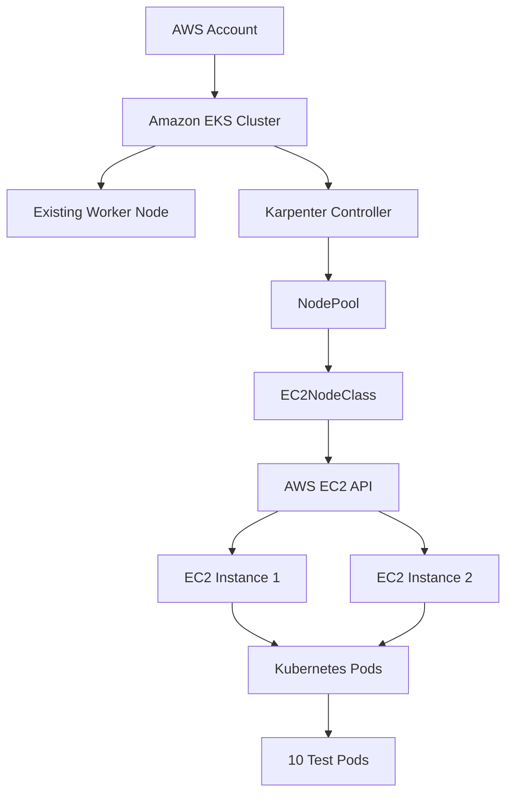
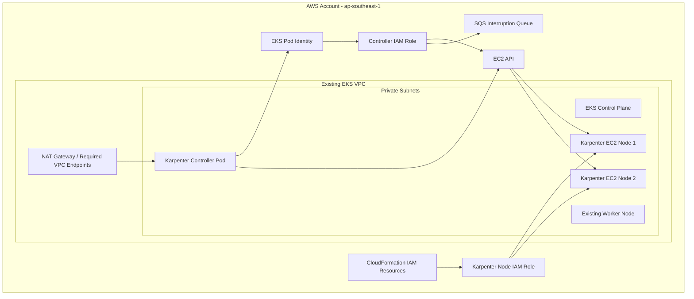
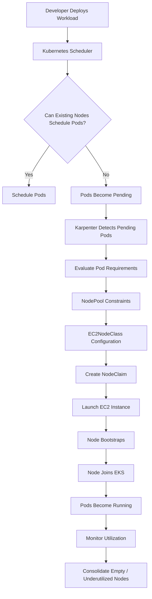
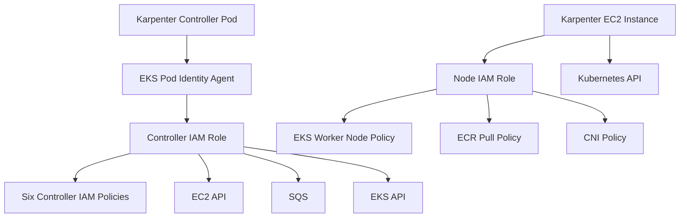
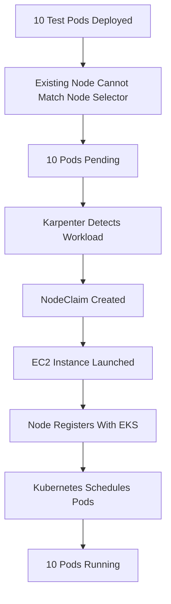
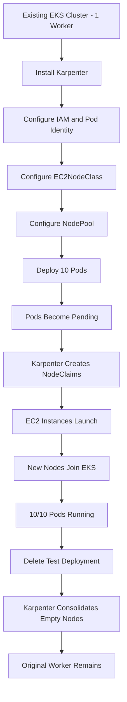

# AWS EKS + Karpenter — Complete Installation & Auto-Scaling Guide

**Production-oriented hands-on implementation**

| Configuration | Value |
|---|---|
| Cloud Provider | AWS |
| Region | `ap-southeast-1` |
| Kubernetes | `1.33` |
| Karpenter | `1.15.3` |
| Authentication | EKS API |
| Controller IAM | EKS Pod Identity |
| Node OS | Amazon Linux 2023 |
| Networking | Private subnets |
| Capacity Type | On-Demand |
| NodePool | `default` |
| Maximum NodePool CPU | 40 vCPUs |
| Test Deployment | 10 pods |

> **Important:** This is an implementation guide for an existing EKS cluster with one worker node. It does not create or replace the EKS cluster itself. Run the dry-run and preflight checks before creating AWS resources.

---

# 1. Project Overview

## What is Karpenter?

Karpenter is a Kubernetes node autoscaler that automatically provisions and terminates infrastructure based on workload requirements.

It monitors unschedulable pods, evaluates their resource requirements, and provisions suitable EC2 instances.

### Without Karpenter

- Administrators manually manage worker nodes.
- Existing nodes may become overloaded.
- Pending pods wait for available capacity.
- Node groups often require additional scaling configuration.

### With Karpenter

- Karpenter observes pending pods.
- It calculates the required resources.
- It selects suitable EC2 instance types.
- It launches new worker nodes.
- Kubernetes schedules workloads on the new nodes.
- Unnecessary nodes can later be consolidated.

**One-line explanation:**

Karpenter = Automatically creates and removes Kubernetes worker nodes based on workload demand.

# 2. Target Architecture

## 2.1 High-level architecture



## 2.2 Detailed AWS architecture



## 2.3 Karpenter provisioning workflow



## 2.4 Main components

| Component | Responsibility |
|---|---|
| EKS | Kubernetes control plane |
| Existing worker | Runs initial workloads and Karpenter controller |
| Karpenter controller | Detects pending pods and manages capacity |
| IAM controller role | Gives Karpenter AWS API permissions |
| Pod Identity | Supplies controller AWS credentials |
| Node IAM role | Provides permissions to EC2 worker nodes |
| NodePool | Defines node provisioning requirements |
| EC2NodeClass | Defines AWS-specific node configuration |
| NodeClaim | Represents a requested node |
| EC2 | Supplies the actual compute infrastructure |
| SQS | Carries interruption events |

# 3. Prerequisites

## 3.1 Existing infrastructure

You must already have:

- An active EKS cluster.
- Kubernetes version 1.33.
- One existing Linux worker node.
- At least one suitable private subnet.
- A working EKS API connection.
- A VPC security group.
- Permissions to manage IAM, EC2, EKS, SQS, CloudFormation and EKS add-ons.

The existing worker node must have sufficient capacity to host the Karpenter controller.

## 3.2 Install required tools

Required tools:

- AWS CLI v2
- kubectl
- Helm 3
- jq
- curl

Verify:

```bash
aws --version
kubectl version --client
helm version
jq --version
curl --version
```

Verify AWS credentials:

```bash
aws sts get-caller-identity
```

## 3.3 Configure the EKS context

```bash
export AWS_REGION="ap-southeast-1"
export CLUSTER_NAME="YOUR_CLUSTER_NAME"

aws eks update-kubeconfig \
  --region "${AWS_REGION}" \
  --name "${CLUSTER_NAME}"
```

Verify:

```bash
kubectl get nodes -o wide
```

Expected initial state:

```text
NAME                          STATUS   ROLES
ip-10-0-1-100.ec2.internal    Ready    <none>
```

# 4. Validate the Existing EKS Cluster

## Step 1: Check cluster status

```bash
aws eks describe-cluster \
  --name "${CLUSTER_NAME}" \
  --region "${AWS_REGION}" \
  --query 'cluster.{Name:name,Status:status,Version:version}'
```

Expected:

```json
{
  "Name": "YOUR_CLUSTER_NAME",
  "Status": "ACTIVE",
  "Version": "1.33"
}
```

## Step 2: Check authentication mode

```bash
aws eks describe-cluster \
  --name "${CLUSTER_NAME}" \
  --region "${AWS_REGION}" \
  --query 'cluster.accessConfig.authenticationMode' \
  --output text
```

Expected:

```text
API
```

We will use EKS access entries for EC2 node authentication.

## Step 3: Get the VPC ID

```bash
VPC_ID=$(aws eks describe-cluster \
  --name "${CLUSTER_NAME}" \
  --region "${AWS_REGION}" \
  --query 'cluster.resourcesVpcConfig.vpcId' \
  --output text)

echo "${VPC_ID}"
```

## Step 4: Get the cluster security group

```bash
CLUSTER_SG=$(aws eks describe-cluster \
  --name "${CLUSTER_NAME}" \
  --region "${AWS_REGION}" \
  --query 'cluster.resourcesVpcConfig.clusterSecurityGroupId' \
  --output text)

echo "${CLUSTER_SG}"
```

## Step 5: Find private subnets

```bash
aws ec2 describe-subnets \
  --region "${AWS_REGION}" \
  --filters "Name=vpc-id,Values=${VPC_ID}" \
  --query 'Subnets[].{Subnet:SubnetId,AZ:AvailabilityZone,PublicIP:MapPublicIpOnLaunch}' \
  --output table
```

Inspect effective route tables to confirm that the selected subnets are private.

A typical private subnet uses a route to a NAT gateway for outbound internet connectivity.

**Important:** `MapPublicIpOnLaunch=false` alone does not prove that a subnet is private.

# 5. Understand the IAM Architecture

Karpenter requires two separate IAM roles.

## 5.1 Controller IAM Role

Example:

```text
YOUR_CLUSTER_NAME-karpenter
```

This role gives Karpenter permission to:

- Discover EC2 resources.
- Create and terminate instances.
- Manage instance profiles.
- Discover EKS cluster resources.
- Read interruption events.
- Manage launch templates.

## 5.2 Node IAM Role

Example:

```text
KarpenterNodeRole-YOUR_CLUSTER_NAME
```

This role gives the newly created worker nodes permissions to:

- Join the EKS cluster.
- Pull container images.
- Use the Amazon VPC CNI permissions.
- Access required AWS services.

## 5.3 IAM architecture



## 5.4 Create the official IAM resources

Set the version:

```bash
export KARPENTER_VERSION="1.15.3"
```

Download the official CloudFormation template:

```bash
curl -fsSL \
  "https://raw.githubusercontent.com/aws/karpenter-provider-aws/v${KARPENTER_VERSION}/website/content/en/preview/getting-started/getting-started-with-karpenter/cloudformation.yaml" \
  -o cloudformation.yaml
```

Validate:

```bash
aws cloudformation validate-template \
  --template-body file://cloudformation.yaml \
  --region "${AWS_REGION}"
```

Deploy:

```bash
aws cloudformation deploy \
  --stack-name "Karpenter-${CLUSTER_NAME}" \
  --template-file cloudformation.yaml \
  --capabilities CAPABILITY_NAMED_IAM \
  --parameter-overrides "ClusterName=${CLUSTER_NAME}" \
  --region "${AWS_REGION}"
```

This creates:

- Karpenter node IAM role.
- Node instance profile.
- Six Karpenter controller managed policies.
- SQS interruption infrastructure.

It does not automatically create the controller IAM role or Pod Identity association.

Reference: https://karpenter.sh/docs/reference/cloudformation/

# 6. Configure Controller IAM Role

## Step 1: Define the role

```bash
ACCOUNT_ID=$(aws sts get-caller-identity \
  --query Account --output text)

CONTROLLER_ROLE="${CLUSTER_NAME}-karpenter"
NODE_ROLE="KarpenterNodeRole-${CLUSTER_NAME}"
```

## Step 2: Create the Pod Identity trust policy

Create `controller-trust.json`:

```json
{
  "Version": "2012-10-17",
  "Statement": [
    {
      "Effect": "Allow",
      "Principal": {
        "Service": "pods.eks.amazonaws.com"
      },
      "Action": [
        "sts:AssumeRole",
        "sts:TagSession"
      ]
    }
  ]
}
```

Create the role:

```bash
aws iam create-role \
  --role-name "${CONTROLLER_ROLE}" \
  --assume-role-policy-document file://controller-trust.json
```

If the role already exists, inspect its trust policy and reuse it only if correctly configured.

## Step 3: Attach the six official policies

```bash
for POLICY in \
  KarpenterControllerNodeLifecyclePolicy \
  KarpenterControllerIAMIntegrationPolicy \
  KarpenterControllerEKSIntegrationPolicy \
  KarpenterControllerInterruptionPolicy \
  KarpenterControllerResourceDiscoveryPolicy \
  KarpenterControllerZonalShiftPolicy
do

  aws iam attach-role-policy \
    --role-name "${CONTROLLER_ROLE}" \
    --policy-arn \
    "arn:aws:iam::${ACCOUNT_ID}:policy/${POLICY}-${CLUSTER_NAME}"

done
```

Verify:

```bash
aws iam list-attached-role-policies \
  --role-name "${CONTROLLER_ROLE}"
```

# 7. Configure EKS Pod Identity

Pod Identity provides AWS credentials to the Karpenter controller without requiring an IRSA OIDC trust configuration.

## Step 1: Install Pod Identity Agent

```bash
aws eks create-addon \
  --cluster-name "${CLUSTER_NAME}" \
  --addon-name eks-pod-identity-agent \
  --region "${AWS_REGION}"
```

If already installed, verify its status instead of creating it again.

Wait:

```bash
aws eks wait addon-active \
  --cluster-name "${CLUSTER_NAME}" \
  --addon-name eks-pod-identity-agent \
  --region "${AWS_REGION}"
```

## Step 2: Create the Pod Identity association

```bash
CONTROLLER_ROLE_ARN=$(aws iam get-role \
  --role-name "${CONTROLLER_ROLE}" \
  --query Role.Arn \
  --output text)
```

Create the association:

```bash
aws eks create-pod-identity-association \
  --cluster-name "${CLUSTER_NAME}" \
  --namespace kube-system \
  --service-account karpenter \
  --role-arn "${CONTROLLER_ROLE_ARN}" \
  --region "${AWS_REGION}"
```

Check:

```bash
aws eks list-pod-identity-associations \
  --cluster-name "${CLUSTER_NAME}" \
  --region "${AWS_REGION}"
```

Do not create a second association for the same service account. Inspect and reuse an existing association.

# 8. Configure Node Authentication

Because the cluster uses EKS API authentication, create an EC2 Linux access entry.

Get the node role ARN:

```bash
NODE_ROLE_ARN=$(aws iam get-role \
  --role-name "${NODE_ROLE}" \
  --query Role.Arn \
  --output text)
```

Create access entry:

```bash
aws eks create-access-entry \
  --cluster-name "${CLUSTER_NAME}" \
  --principal-arn "${NODE_ROLE_ARN}" \
  --type EC2_LINUX \
  --region "${AWS_REGION}"
```

Verify:

```bash
aws eks describe-access-entry \
  --cluster-name "${CLUSTER_NAME}" \
  --principal-arn "${NODE_ROLE_ARN}" \
  --region "${AWS_REGION}"
```

This allows EC2 Linux instances using the specified IAM role to authenticate as EKS worker nodes.

# 9. Configure AWS Network Discovery

Karpenter must discover the private subnets and security groups that it can use when launching EC2 instances.

## Step 1: Tag private subnets

```bash
for SUBNET in subnet-xxxxxxxx subnet-yyyyyyyy
do

  aws ec2 create-tags \
    --resources "${SUBNET}" \
    --region "${AWS_REGION}" \
    --tags \
      "Key=karpenter.sh/discovery,Value=${CLUSTER_NAME}"

done
```

Replace the example IDs with actual private subnet IDs.

## Step 2: Tag the cluster security group

```bash
aws ec2 create-tags \
  --resources "${CLUSTER_SG}" \
  --region "${AWS_REGION}" \
  --tags \
    "Key=karpenter.sh/discovery,Value=${CLUSTER_NAME}"
```

## Step 3: Verify tags

```bash
aws ec2 describe-subnets \
  --region "${AWS_REGION}" \
  --filters \
    "Name=tag:karpenter.sh/discovery,Values=${CLUSTER_NAME}" \
  --output table
```

Verify security groups:

```bash
aws ec2 describe-security-groups \
  --region "${AWS_REGION}" \
  --filters \
    "Name=tag:karpenter.sh/discovery,Values=${CLUSTER_NAME}" \
  --output table
```

# 10. Private Networking Requirements

Private subnets do not necessarily mean that the cluster is an isolated private cluster.

For this implementation, ensure that the controller and nodes can reach the required AWS services.

A NAT gateway can provide outbound connectivity.

For an isolated VPC without outbound internet access, configure the required VPC endpoints and ensure images are available through an accessible registry.

Important endpoints include:

| Endpoint | Purpose |
|---|---|
| EC2 | Instance provisioning |
| ECR API | Image authentication and metadata |
| ECR DKR | Image registry |
| S3 | Image layers and other required objects |
| EKS Auth | Pod Identity credential delivery |
| SSM | AMI discovery |
| SQS | Interruption handling |
| EKS | Cluster discovery |

For isolated VPCs, the standard `EC2NodeClass.spec.role` approach also needs special handling: the IAM API has no VPC private endpoint. Use a pre-created instance profile and `spec.instanceProfile` instead.

Official reference: https://karpenter.sh/v1.15/getting-started/getting-started-with-karpenter/

# 11. Install Karpenter

## Step 1: Set the version

```bash
export KARPENTER_VERSION="1.15.3"
export KARPENTER_NAMESPACE="kube-system"
```

## Step 2: Check chart availability

```bash
helm show chart \
  oci://public.ecr.aws/karpenter/karpenter \
  --version "${KARPENTER_VERSION}"
```

## Step 3: Install Karpenter

```bash
helm registry logout public.ecr.aws

helm upgrade --install karpenter \
  oci://public.ecr.aws/karpenter/karpenter \
  --version "${KARPENTER_VERSION}" \
  --namespace "${KARPENTER_NAMESPACE}" \
  --create-namespace \
  --set "settings.clusterName=${CLUSTER_NAME}" \
  --set "settings.interruptionQueue=${CLUSTER_NAME}" \
  --set "serviceAccount.name=karpenter" \
  --set "controller.resources.requests.cpu=1" \
  --set "controller.resources.requests.memory=1Gi" \
  --set "controller.resources.limits.cpu=1" \
  --set "controller.resources.limits.memory=1Gi" \
  --wait \
  --timeout 10m
```

The official v1.15 Helm chart manages its CRDs. Do not install a second, independently versioned CRD chart unnecessarily.

## Step 4: Verify controller

```bash
kubectl get pods -n kube-system \
  -l app.kubernetes.io/name=karpenter
```

Expected:

```text
NAME                         READY   STATUS
karpenter-xxxxxxxxxx-xxxxx   1/1     Running
```

Check logs:

```bash
kubectl logs \
  -n kube-system \
  deployment/karpenter \
  --all-containers=true \
  --tail=100
```

# 12. Determine the EKS Optimized AMI

For reproducibility, resolve the recommended Amazon Linux 2023 AMI version for Kubernetes 1.33.

```bash
AMI_ID=$(aws ssm get-parameter \
  --name "/aws/service/eks/optimized-ami/1.33/amazon-linux-2023/x86_64/standard/recommended/image_id" \
  --region "${AWS_REGION}" \
  --query Parameter.Value \
  --output text)
```

Get its name:

```bash
AMI_NAME=$(aws ec2 describe-images \
  --region "${AWS_REGION}" \
  --image-ids "${AMI_ID}" \
  --query 'Images[0].Name' \
  --output text)
```

Extract the AMI version:

```bash
ALIAS_VERSION=$(echo "${AMI_NAME}" |
  sed -E 's/.*(v[0-9]+).*/\1/')
```

Check:

```bash
echo "${ALIAS_VERSION}"
```

This version can be pinned in the EC2NodeClass instead of automatically tracking the latest AMI.

# 13. Create EC2NodeClass

EC2NodeClass defines AWS-specific infrastructure settings.

It specifies:

- EC2 node IAM role.
- AMI selection.
- Private subnet discovery.
- Security group discovery.
- Other EC2 configuration.

Create `ec2nodeclass.yaml`:

```yaml
apiVersion: karpenter.k8s.aws/v1
kind: EC2NodeClass

metadata:
  name: default

spec:
  role: "KarpenterNodeRole-YOUR_CLUSTER_NAME"

  amiSelectorTerms:
    - alias: "al2023@YOUR_AMI_VERSION"

  subnetSelectorTerms:
    - tags:
        karpenter.sh/discovery: "YOUR_CLUSTER_NAME"

  securityGroupSelectorTerms:
    - tags:
        karpenter.sh/discovery: "YOUR_CLUSTER_NAME"
```

Replace the cluster name and AMI version.

Validate:

```bash
kubectl apply \
  --dry-run=server \
  -f ec2nodeclass.yaml
```

Apply:

```bash
kubectl apply -f ec2nodeclass.yaml
```

Verify:

```bash
kubectl get ec2nodeclass
kubectl describe ec2nodeclass default
```

Expected:

```text
NAME      READY
default   True
```

# 14. Create NodePool

NodePool defines the types of EC2 capacity Karpenter can provision.

Create `nodepool.yaml`:

```yaml
apiVersion: karpenter.sh/v1
kind: NodePool

metadata:
  name: default

spec:
  template:
    spec:
      requirements:

        - key: kubernetes.io/arch
          operator: In
          values:
            - amd64

        - key: kubernetes.io/os
          operator: In
          values:
            - linux

        - key: karpenter.sh/capacity-type
          operator: In
          values:
            - on-demand

        - key: karpenter.k8s.aws/instance-category
          operator: In
          values:
            - c
            - m
            - r

        - key: karpenter.k8s.aws/instance-generation
          operator: Gt
          values:
            - "2"

      nodeClassRef:
        group: karpenter.k8s.aws
        kind: EC2NodeClass
        name: default

      expireAfter: 720h

  limits:
    cpu: "40"

  disruption:
    consolidationPolicy: WhenEmptyOrUnderutilized
    consolidateAfter: 5m
```

## Understand the configuration

| Setting | Meaning |
|---|---|
| `amd64` | Only x86-64 instances |
| `linux` | Linux worker nodes |
| `on-demand` | Avoid Spot interruptions |
| `c` | Compute optimized |
| `m` | General purpose |
| `r` | Memory optimized |
| Generation > 2 | Avoid older EC2 generations |
| `expireAfter` | Maximum node lifetime |
| `cpu: 40` | NodePool CPU limit |
| `consolidateAfter: 5m` | Delay before consolidation |

Validate:

```bash
kubectl apply \
  --dry-run=server \
  -f nodepool.yaml
```

Apply:

```bash
kubectl apply -f nodepool.yaml
```

Verify:

```bash
kubectl get nodepool
kubectl describe nodepool default
```

# 15. Validate Karpenter Before Scaling

Run the following:

```bash
kubectl get pods -n kube-system
kubectl get nodepool
kubectl get ec2nodeclass
kubectl get nodeclaims
kubectl get nodes
```

Expected initial condition:

- Karpenter controller is running.
- NodePool is Ready.
- EC2NodeClass is Ready.
- No Karpenter NodeClaims exist yet.
- Original worker node remains Ready.

A zero NodeClaim count is normal until a workload requires additional capacity.

# 16. Deploy 10 Test Pods

This is the main scaling demonstration.

We will deploy 10 pods that request one CPU and 512 MiB of memory each.

Total requested resources:

| Resource | Total |
|---|---:|
| Pods | 10 |
| CPU | 10 cores |
| Memory | 5 GiB |

Create `karpenter-test.yaml`:

```yaml
apiVersion: apps/v1
kind: Deployment

metadata:
  name: karpenter-test

spec:
  replicas: 10

  selector:
    matchLabels:
      app: karpenter-test

  template:
    metadata:
      labels:
        app: karpenter-test

    spec:
      terminationGracePeriodSeconds: 0

      nodeSelector:
        karpenter.sh/nodepool: default

      containers:
        - name: pause
          image: public.ecr.aws/eks-distro/kubernetes/pause:3.7

          resources:
            requests:
              cpu: "1"
              memory: "512Mi"

          securityContext:
            allowPrivilegeEscalation: false
```

The node selector ensures these test pods run on Karpenter-managed nodes rather than your original worker.

## Step 1: Apply the deployment

```bash
kubectl apply -f karpenter-test.yaml
```

## Step 2: Observe pending pods

```bash
kubectl get pods \
  -l app=karpenter-test \
  -o wide
```

Initially, the pods should be Pending until Karpenter provisions matching capacity.

## Step 3: Monitor NodeClaims

Open a separate terminal:

```bash
kubectl get nodeclaims -w
```

## Step 4: Monitor EC2 worker nodes

```bash
kubectl get nodes -w
```

## Step 5: Monitor controller logs

```bash
kubectl logs \
  -f \
  -n kube-system \
  deployment/karpenter \
  --all-containers=true
```

# 17. Expected Scaling Architecture



Karpenter determines the number and size of nodes based on scheduling requirements and available EC2 capacity.

**Important:** Ten pods do not necessarily mean ten nodes. One appropriately sized instance may run all ten pods, or Karpenter may choose multiple instances.

# 18. Expected Verification Output

These are representative examples, not captured AWS execution logs.

## A. Verify nodes

```bash
kubectl get nodes \
  -L karpenter.sh/nodepool,node.kubernetes.io/instance-type
```

Example:

```text
NAME                         STATUS   NODEPOOL   INSTANCE-TYPE
ip-10-0-1-100.ec2.internal   Ready    <none>     m5.large
ip-10-0-2-100.ec2.internal   Ready    default    m5.2xlarge
```

## B. Verify NodeClaims

```bash
kubectl get nodeclaims
```

Example:

```text
NAME            TYPE         CAPACITY    ZONE
default-abc12   m5.2xlarge   on-demand   ap-southeast-1a
```

## C. Verify all pods

```bash
kubectl get pods \
  -l app=karpenter-test \
  -o wide
```

Expected deployment:

```text
NAME             READY   UP-TO-DATE   AVAILABLE
karpenter-test   10/10   10           10
```

## D. Confirm workload placement

```bash
kubectl get pods \
  -l app=karpenter-test \
  -o custom-columns=NAME:.metadata.name,NODE:.spec.nodeName,STATUS:.status.phase
```

Success criteria:

- 10 pods created.
- 10 pods Running.
- At least one additional Karpenter-managed worker node.
- Original worker remains Ready.
- NodeClaims become Ready.

# 19. Test Scale-Down and Consolidation

Karpenter can consolidate unnecessary nodes after workloads are removed.

Delete the test workload:

```bash
kubectl delete deployment karpenter-test
```

Monitor:

```bash
kubectl get nodes -w
```

Monitor NodeClaims:

```bash
kubectl get nodeclaims -w
```

Check Karpenter logs:

```bash
kubectl logs \
  -f \
  -n kube-system \
  deployment/karpenter \
  --all-containers=true
```

With this NodePool configuration:

```yaml
disruption:
  consolidationPolicy: WhenEmptyOrUnderutilized
  consolidateAfter: 5m
```

Karpenter can remove empty or underutilized nodes when disruption conditions permit.

Expected final state:

```text
NAME                         STATUS
ip-10-0-1-100.ec2.internal   Ready
```

The original worker remains. Karpenter-provisioned empty nodes are terminated after successful consolidation.

# 20. Troubleshooting Guide

| Error | Likely reason | Resolution |
|---|---|---|
| `AccessDenied` | Incorrect controller role permissions | Verify all six policies |
| `NodeClass NotReady` | Discovery tags or AMI issue | Inspect EC2NodeClass conditions |
| `No subnets found` | Subnet tags missing | Verify discovery tags |
| `No security groups found` | Security-group discovery issue | Check VPC and SG tags |
| `NodeClaim Failed` | EC2 launch or IAM issue | Inspect NodeClaim events |
| `Node not joining` | Node IAM or networking issue | Check access entry and node bootstrap |
| `InsufficientInstanceCapacity` | EC2 capacity shortage | Allow more instance families and AZs |
| `ImagePullBackOff` | Registry connectivity issue | Check NAT, endpoints and registry access |
| `AssumeRoleWithWebIdentity` | IRSA/Pod Identity mismatch | Check authentication configuration |
| `Pod Identity credentials unavailable` | Agent or association issue | Verify agent and role association |
| `Pods Pending` | Scheduling constraints conflict | Inspect pod events and NodePool requirements |

## Useful debugging commands

### Controller logs

```bash
kubectl logs \
  -n kube-system \
  deployment/karpenter \
  --all-containers=true \
  --tail=200
```

### NodeClaim details

```bash
kubectl describe nodeclaim NODECLAIM_NAME
```

### NodePool details

```bash
kubectl describe nodepool default
```

### EC2NodeClass details

```bash
kubectl describe ec2nodeclass default
```

### Pod events

```bash
kubectl describe pod POD_NAME
```

### IAM policies

```bash
aws iam list-attached-role-policies \
  --role-name "${CLUSTER_NAME}-karpenter"
```

### EKS access entry

```bash
aws eks describe-access-entry \
  --cluster-name "${CLUSTER_NAME}" \
  --principal-arn "${NODE_ROLE_ARN}" \
  --region "${AWS_REGION}"
```

# 21. Dry-Run and Validation Strategy

Before installing infrastructure, use these checks.

## Configuration validation

```bash
aws sts get-caller-identity

aws eks describe-cluster \
  --name "${CLUSTER_NAME}" \
  --region "${AWS_REGION}"

kubectl get nodes

helm show chart \
  oci://public.ecr.aws/karpenter/karpenter \
  --version "${KARPENTER_VERSION}"
```

## CloudFormation validation

```bash
aws cloudformation validate-template \
  --template-body file://cloudformation.yaml \
  --region "${AWS_REGION}"
```

## Kubernetes server-side dry-run

```bash
kubectl apply \
  --dry-run=server \
  -f ec2nodeclass.yaml

kubectl apply \
  --dry-run=server \
  -f nodepool.yaml

kubectl apply \
  --dry-run=server \
  -f karpenter-test.yaml
```

These checks validate the resources and configuration without applying them.

**Important:** A dry-run does not prove that future EC2 launches, IAM operations, subnet routing, or AWS capacity will succeed. Those require live verification.

# 22. Production Readiness Checklist

- [ ] EKS cluster is ACTIVE.
- [ ] Kubernetes version is 1.33.
- [ ] Authentication mode is API.
- [ ] Original worker node is Ready.
- [ ] Private subnet routing is validated.
- [ ] Security group rules are validated.
- [ ] Controller IAM role exists.
- [ ] Six controller policies are attached.
- [ ] Node IAM role exists.
- [ ] Pod Identity Agent is active.
- [ ] Pod Identity association exists.
- [ ] EC2 Linux access entry exists.
- [ ] Discovery tags are configured.
- [ ] Karpenter Helm release is deployed.
- [ ] EC2NodeClass is Ready.
- [ ] NodePool is Ready.
- [ ] NodeClaims are created.
- [ ] Ten pods are Running.
- [ ] Additional EC2 nodes join EKS.
- [ ] Scale-down and consolidation are tested.

# 23. Cost and Safety Considerations

Karpenter launches real AWS EC2 infrastructure.

The NodePool CPU limit is a maximum capacity limit, not a guaranteed number of cores that will be provisioned.

Before testing:

- Confirm your EC2 service quotas.
- Check available instance types in your region.
- Confirm subnet IP availability.
- Check NAT gateway and VPC endpoint costs.
- Use On-Demand instances for predictable testing.
- Delete test workloads after the demonstration.
- Keep the original worker node available.
- Review disruption settings before production use.

# 24. Cleanup

Remove the test workload:

```bash
kubectl delete deployment karpenter-test \
  --ignore-not-found
```

Remove the NodePool and EC2NodeClass after ensuring there are no workloads that depend on Karpenter capacity:

```bash
kubectl delete nodepool default \
  --ignore-not-found

kubectl delete ec2nodeclass default \
  --ignore-not-found
```

Wait for Karpenter-managed nodes to be terminated and verify there are no remaining NodeClaims.

Then uninstall Karpenter:

```bash
helm uninstall karpenter \
  --namespace kube-system
```

Do not immediately delete the IAM role, CloudFormation stack or SQS queue if any other NodePool or Karpenter installation still uses them.

Remove the CloudFormation stack only after confirming that its resources are no longer needed:

```bash
aws cloudformation delete-stack \
  --stack-name "Karpenter-${CLUSTER_NAME}" \
  --region "${AWS_REGION}"
```

Review remaining IAM roles, policies, access entries, Pod Identity associations, SQS queues and EC2 launch templates before removing them.

Do not delete the existing EKS cluster or its original worker node as part of this Karpenter cleanup.

# 25. Final Expected Result

The objective of this implementation is to demonstrate the following complete lifecycle:



**Final success criteria:**

1. Karpenter controller is running.
2. NodePool is Ready.
3. EC2NodeClass is Ready.
4. Ten test pods are Running.
5. At least one additional EC2 worker node is provisioned.
6. Original worker node remains healthy.
7. Empty Karpenter nodes are consolidated when eligible.

# 26. Official Documentation

Use these official resources as the primary reference:

1. Karpenter installation: https://karpenter.sh/v1.15/getting-started/getting-started-with-karpenter/
2. Karpenter CloudFormation: https://karpenter.sh/docs/reference/cloudformation/
3. Karpenter NodePools: https://karpenter.sh/docs/concepts/nodepools/
4. Karpenter EC2NodeClasses: https://karpenter.sh/docs/concepts/nodeclasses/
5. Karpenter NodeClaims: https://karpenter.sh/docs/concepts/nodeclaims/
6. AWS EKS Pod Identity: https://docs.aws.amazon.com/eks/latest/userguide/pod-identities.html
7. AWS EKS Access Entries: https://docs.aws.amazon.com/eks/latest/userguide/access-entries.html

---

**Project takeaway**

Karpenter provides intelligent Kubernetes infrastructure autoscaling by dynamically provisioning EC2 instances based on pending pod requirements and removing unnecessary capacity when it is no longer required.

**One existing worker → Karpenter installation → 10 pending pods → EC2 provisioning → 10 running pods → automatic consolidation.**